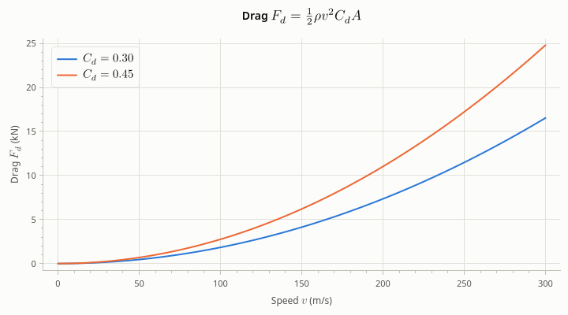
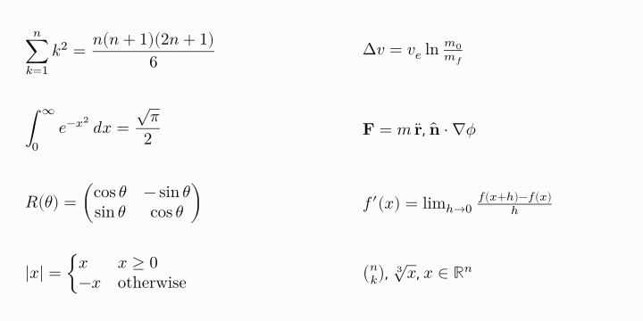
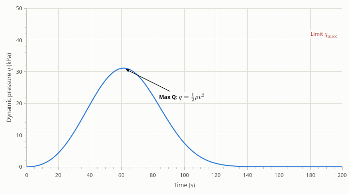

# Math notation

[User Guide](index.md) · previous: [Appearance](appearance.md) · next: [Export](export.md)

Titles, axis labels, legend names and annotation texts can hold math between `$` signs, written as in LaTeX:
`"Speed $v_z$ (m/s)"`. The library typesets it as TeX does, in Latin Modern Math (the font of LaTeX's math),
which it has inside it: it needs no LaTeX installation and no font on the computer.



<!-- example: math-labels -->
```cpp
plot->setTitle(R"(Drag $F_d = \tfrac{1}{2}\rho v^2 C_d A$)");
plot->xAxis()->setLabel("Speed $v$ (m/s)");
plot->yAxis()->setLabel("Drag $F_d$ (kN)");
plot->addLine(speed, low, "$C_d = 0.30$");
plot->addLine(speed, high, "$C_d = 0.45$");
```

## Writing math

A string with a pair of `$` signs has math between them; one with several pairs alternates between text and
math. The rule is matplotlib's:

- A string with an odd number of `$` signs is all text, so a price such as `"Cost ($)"` stays as it is.
- `\$` is a dollar sign, in text and in math: `"From \$5 to \$10"` shows `From $5 to $10`.
- A string without `$` is plain text or rich text, exactly as before.

A formula is TeX, and TeX is full of backslashes, which a C++ string literal wants doubled (`"$\\alpha$"`).
A raw string literal takes them as they are: `R"($\alpha$)"`. The examples here use raw strings for every
formula with a backslash.

Spaces in a formula don't count (TeX makes its own); `\,` and `\quad` make space where you want it.

## What can be written

| What | How |
| --- | --- |
| Letters, Greek | `x` is italic, `2` upright; `\alpha` to `\omega`, `\Gamma` to `\Omega`, `\varepsilon`, `\varphi`, ... |
| Scripts, primes | `x^2`, `x_i`, `x_{ij}^{n+1}`, `f'`, `f''(x)` |
| Fractions | `\frac{a}{b}`, `\tfrac{1}{2}` (small), `\dfrac{a}{b}` (large), `\binom{n}{k}` |
| Roots | `\sqrt{x}`, `\sqrt[3]{x}` |
| Large operators | `\sum_{i=1}^n`, `\prod`, `\int_0^1`, `\iint`, `\oint`, `\bigcup`; `\limits` and `\nolimits` |
| Functions | `\sin`, `\cos`, `\log`, `\ln`, `\exp`, `\lim_{x\to 0}`, `\max`, `\det`, ...; `\operatorname{tr}`, `\operatorname*{argmax}` |
| Relations, operations | `\leq`, `\geq`, `\neq`, `\approx`, `\equiv`, `\sim`, `\propto`, `\in`, `\subset`, `\pm`, `\times`, `\cdot`, `\to`, `\Rightarrow`, `\not=`, ... |
| Other symbols | `\infty`, `\partial`, `\nabla`, `\forall`, `\exists`, `\hbar`, `\ell`, `\ldots`, `\cdots`, `\degree`, ... |
| Delimiters | `\left( ... \right)` grow with what they hold (also `[`, `\{`, `\langle`, `|`, `\|`, `\lfloor`, `\lceil`, and `.` for none); `\big(`, `\Big(`, `\bigg(`, `\Bigg(` |
| Accents | `\hat{x}`, `\bar{x}`, `\vec{v}`, `\dot{x}`, `\ddot{x}`, `\tilde{n}`, `\widehat{xyz}`, `\overline{AB}`, `\underline{x}`, `\overrightarrow{AB}` |
| Alphabets | `\mathrm{d}x`, `\mathbf{F}`, `\boldsymbol{\alpha}`, `\mathbb{R}`, `\mathcal{L}`, `\mathfrak{g}`, `\mathsf{T}`, `\mathtt{x}` |
| Text | `\text{if}`, `\textbf{max}`, `\textit{e.g.}` |
| Spaces | `\,` `\:` `\;` (thin to thick), `\!` (back), `\quad`, `\qquad`, `~` |
| Matrices | `\begin{matrix} a & b \\ c & d \end{matrix}`; `pmatrix`, `bmatrix`, `Bmatrix`, `vmatrix`, `Vmatrix` have delimiters |
| Cases | `\begin{cases} x & x \geq 0 \\ -x & \text{otherwise} \end{cases}` |



A formula is set in TeX's *text style*, as math between `$` signs in a paragraph is: fractions are small and the
limits of a sum go beside it. `\displaystyle` sets the rest of a formula in display style, with large fractions
and limits above and below; the formulas on the left above start with it.

## Math in rich text

Math and Qt rich text mix. A formula takes the size and the color of the text around it, so a `<span>` that
makes text larger or red does the same to a formula inside it.



<!-- example: math-rich-text -->
```cpp
plot->addText(at, *peak, R"(<b>Max Q</b>: $q = \frac{1}{2}\rho v^2$)")
    ->setOffset({120.0, 60.0});
plot->addHorizontalLine(40.0, R"(<span style="color:#b03a2e">Limit $q_\max$</span>)");
```

## Size, color and font

A formula is drawn at the size of the text around it, in its color. Next to a sans-serif font, whose lower case
letters are taller than Latin Modern's, it is made a little larger (up to a quarter), so that its letters look as
large as the text's.

Another installed OpenType math font (one with a MATH table) can take Latin Modern's place, for one plot or for a
whole grid of them:

<!-- sketch -->
```cpp
plot->setMathFontFamily("STIX Two Math");  // or "Cambria Math", "Libertinus Math", ...
grid->setMathFontFamily("STIX Two Math");  // the title and every plot of a PlotGrid
plot->resetMathFontFamily();               // back to Latin Modern Math
```

A family that isn't installed, or isn't a math font, is replaced by Latin Modern Math, with a warning.

## Exports and plain text

Math is drawn as outlines, not as text in a font. It looks the same on the screen, in an image and in SVG and
PDF files, whatever fonts the reader of the file has; the text around it stays text. A formula can't be searched
or selected in a drawing.

Where only text goes (the title of an SVG or PDF file, the header of the CSV of the data in view), a formula is
written as plain text: `$v_z$` as `v_z`, `$\alpha^2$` as `α^2`, `$\frac{a}{b}$` as `a/b`, `$\sqrt{x}$` as `√x`.

<!-- example: math-csv -->
```cpp
plot->xAxis()->setLabel("Time $t$ (s)");
plot->addLine(std::vector<double>{0.0, 1.0}, std::vector<double>{2.0, 4.5}, "$v_z$");
plot->addLine(std::vector<double>{0.0, 1.0}, std::vector<double>{0.0, 9.8}, R"($\frac{F}{m}$)");
const QString text = plot->toCsv();
```

<!-- output: math-csv -->
```
Time t (s),v_z,F/m
0,2,0
1,4.5,9.8

```

## When a formula is wrong

A formula that can't be typeset (`$\fracc{1}{2}$`, `$x^2^3$`, a `{` without its `}`) is shown as it was typed,
with its `$` signs, and a warning in the log (category `rocketplot.render`) says what is wrong and where:

```text
Can't typeset \fracc{1}{2} : Unknown command \fracc (at 0)
```

## What it doesn't do

- No macros (`\newcommand`, `\def`), and of LaTeX's environments only the matrices and `cases`: no `align`, no
  `array` with a column specification.
- No `\middle`, no `\color`: color a formula with rich text, as above.
- No line breaks inside a formula.
- `\text{...}` has the characters of the math font: Latin and Greek, not Cyrillic or Chinese.
- In rich text, `<sub>` and `<sup>` around a formula don't move it: write the script in the formula.

Next: [Export](export.md).
